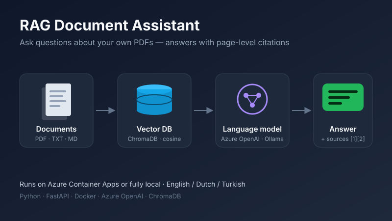

# rag-demo — RAG document assistant with a guarded agent, local or on Azure

[](https://github.com/Elcebir71/rag-demo/actions/workflows/tests.yml)



A small **Retrieval-Augmented Generation (RAG)** service in plain Python. It indexes
your documents, retrieves the passages most relevant to a question, and lets a language
model answer from those passages only, citing the file and page each claim came from.

The same code runs in two modes, selected by environment variables:

| | Local | Cloud |
|---|---|---|
| Chat model | Ollama `qwen2.5:7b` | Azure OpenAI `gpt-5-mini` |
| Embeddings | Ollama `bge-m3` | Azure OpenAI `text-embedding-3-small` |
| Hosting | your machine | Azure Container Apps |
| Cost / keys | free, no keys | pay per token, key stored as a secret |

**Live demo:** https://rag-demo.orangeocean-d98c39b7.swedencentral.azurecontainerapps.io
(scales to zero when idle, so the first request can take a few seconds)

## How it works

```
docs/  (PDF, TXT, MD)
   │  ingest.py   split into overlapping chunks → embed → store in ChromaDB
   ▼
db/    (vector database, one collection per embedding model)
   │  ask.py / api.py   embed the question → retrieve top-4 chunks → ask the model
   ▼
Answer with source citations  [1] file.pdf, page 13
```

| File | Role |
|---|---|
| `config.py` | Settings and backend selection from environment variables |
| `llm_client.py` | One interface (`embed`, `chat`) over Azure OpenAI and Ollama, with rate-limit retries |
| `ingest.py` | **Indexing** — read documents, chunk, embed, store |
| `ask.py` | **Retrieval + generation** from the command line |
| `api.py` | The same pipeline as a REST API (FastAPI) |
| `tools.py` | Agent tool registry: schemas, risk levels, validation and business rules |
| `store.py` | Agent state in SQLite: actions, audit log, notes, outbox |
| `agent.py` | Agent loop, approve and reject |
| `evals/` | Retrieval and answer quality checks against a fixed set of questions |
| `tests/` | Tests for the agent's guarantees, with a scripted fake model |
| `Dockerfile` | Container image with the app and the prebuilt index |

## API

| Method | Path | Purpose |
|---|---|---|
| `GET` | `/health` | Liveness check; also reports the active backend |
| `POST` | `/ask` | Body `{"question": "..."}` → `{"answer": "...", "sources": [...]}` |
| `GET` | `/docs` | Interactive OpenAPI page |
| `POST` | `/agent` | Body `{"message": "..."}` → answer plus the actions the agent proposed (needs `x-admin-key`) |
| `GET` | `/actions?status=pending` | Actions waiting for review (needs `x-admin-key`) |
| `POST` | `/actions/{id}/approve` or `/reject` | Human decision (needs `x-admin-key`) |
| `GET` | `/actions/{id}/audit` | Audit trail of one action (needs `x-admin-key`) |

```json
{
  "answer": "IaaS requires the most user management: you manage the operating systems, data and applications ... [1][3]",
  "sources": [
    {"source": "file.pdf", "page": 13, "similarity": 0.65, "chunk_id": "file.pdf-p13-c0",
     "snippet": "Infrastructure as a service (IaaS) is the most flexible ...", "cited": true},
    {"source": "file.pdf", "page": 15, "similarity": 0.51, "chunk_id": "file.pdf-p15-c1",
     "snippet": "Platform as a service (PaaS) provides ...", "cited": false}
  ],
  "invalid_citations": []
}
```

Each source names the exact chunk it came from (`chunk_id`) and starts with its text (`snippet`),
so a reader can check the answer. `cited` says whether the answer refers to that source as `[n]`;
`invalid_citations` lists numbers the answer cites that were never retrieved (like `[6]` with 4 sources).

**Request trace (off by default).** Set `PROVENANCE_LOG=provenance.jsonl` and every `/ask` adds one
JSON line: time, question, backend and model, when the index was built (`indexed_at`), the chunk ids
with their similarity, the answer and its citations. The API is public, so storing questions is
a deliberate choice, not a default. A failed write is logged and never breaks an answer.

## Agent with guarded actions

The assistant can also act: search the documents, save notes and send email.
On the live demo the RAG endpoints are public; the agent endpoints need the admin key.
The design follows one rule: **the model proposes, the application decides.**
A prompt guides the model's reasoning, but permissions, validation, approval and
recovery are enforced in code, where no prompt or document can change them.

```
request ─▶ model proposes tool calls
              │
              ▼
        tools.validate()  ── unknown tool, bad arguments,
              │              recipient not on allowlist ──▶ rejected (logged)
              ▼
         risk level?
     read / low ──▶ run now ──▶ done / failed (logged)
     high ───────▶ pending ──▶ human approves with admin key ──▶ re-check ──▶ run
```

| Tool | Risk | What the application does |
|---|---|---|
| `search_documents` | read | Runs automatically |
| `save_note` | low | Runs automatically and is logged |
| `send_email` | high | Waits for approval; recipient must be on `EMAIL_ALLOWLIST` |

**Guarantees, each covered by a test in `tests/`**

- Unknown tools, extra fields and malformed arguments are rejected (strict Pydantic schemas).
- A recipient outside the allowlist is rejected, even when a document contains
  an injected instruction and the model follows it.
- Nothing high-risk runs without approval, and approval needs `ADMIN_API_KEY`.
  Without a configured key, approvals are disabled (fail closed).
- Approving twice runs once: every status change is a conditional update.
- Rules are checked again at approval time, not only at proposal time.
- Failures are recorded, never lost; the loop stops after `MAX_STEPS` rounds.
- Every status change is written to an audit log. A document search records which chunks
  it found (`Found: file.pdf-p13-c0 (0.65), ...`), and the agent cites them as `[file.pdf-p13-c0]`.

Email runs in **demo mode**: an approved email goes to an `outbox` table and is not
sent. A public demo that sends real email could be abused as a spam relay.

**Limits of this demo, stated openly**

- `/agent` needs the admin key too. Each request can make up to `MAX_STEPS` model calls,
  so a public agent endpoint would let anyone spend the Azure budget.
- Agent state is SQLite inside the container. With `--min-replicas 0` the container stops
  when idle, and pending actions and the audit log are lost. Fine for a demo where an
  action is approved within minutes; a real deployment would use PostgreSQL (see roadmap).
  
**Model choice, measured, not assumed.** Same tool definition, three runs each:

| Model | System prompt | Unwanted tool calls | Correct tool calls |
|---|---|---|---|
| llama3.2 (3B) | no | 3/3 | 3/3 |
| llama3.2 (3B) | yes | 1/3 | 3/3 |
| qwen2.5:7b | no | 0/3 | 3/3 |
| qwen2.5:7b | yes | 0/3 | 3/3 |

`qwen2.5:7b` is the default (`AGENT_MODEL`). After a document search it often
asks the user for confirmation instead of proposing the next action. With Azure OpenAI
(`gpt-5-mini`) the same code and prompt complete the task in one go: the search runs and
the email is held for approval. The guarantees do not depend on the model; its usefulness does.

**Try it**

```bash
# PowerShell: $env:EMAIL_ALLOWLIST = "jan@example.com"; $env:ADMIN_API_KEY = "local-test-key"
python agent.py "Email jan@example.com with subject 'Test' and body 'Hello'"
python agent.py --approve <id>   # the id printed by the previous command
python -m pytest -q              # needs: pip install -r requirements-dev.txt
```

The agent's endpoints are listed in the API table above.

## Run locally (free, no keys)

```bash
ollama pull bge-m3
ollama pull qwen2.5:7b              # chat model and agent

python -m venv .venv
.venv\Scripts\activate            # macOS/Linux: source .venv/bin/activate
pip install -r requirements.txt

python ingest.py                  # index everything in docs/
python ask.py "your question"     # command line
python -m uvicorn api:app --reload   # REST API on http://127.0.0.1:8000/docs
```

## Run against Azure OpenAI

Set two environment variables and the app switches backend. The key is read straight
from Azure into the shell, so it is never written to a file (PowerShell shown):

```powershell
$env:AZURE_OPENAI_ENDPOINT = az cognitiveservices account show -n <aoai-name> -g <rg> --query properties.endpoint -o tsv
$env:AZURE_OPENAI_API_KEY  = az cognitiveservices account keys list -n <aoai-name> -g <rg> --query key1 -o tsv

python ingest.py                  # rebuilds the index with Azure embeddings
python ask.py "your question"
```

Optional variables: `AZURE_CHAT_DEPLOYMENT` (default `chat`), `AZURE_EMBED_DEPLOYMENT`
(default `text-embedding-3-small`), `AZURE_REASONING_EFFORT` (default `low`).

## Deploy to Azure Container Apps

```powershell
# One-time infrastructure
az group create -n <rg> -l swedencentral
az acr create -g <rg> -n <acr> --sku Basic
az containerapp env create -n <env> -g <rg> -l swedencentral

# Vector index image: built by hand, only when the documents change
az acr login -n <acr>
docker build -f Dockerfile.index -t <acr>.azurecr.io/rag-index:v1 .
docker push <acr>.azurecr.io/rag-index:v1

# App image: GitHub Actions does this on every merge to main (see below)
docker build --build-arg INDEX_IMAGE=<acr>.azurecr.io/rag-index:v1 -t <acr>.azurecr.io/rag-demo:v2 .
docker push <acr>.azurecr.io/rag-demo:v2

# Create the app (image pulled with a managed identity, no registry password)
az containerapp create -n rag-demo -g <rg> --environment <env> `
  --image <acr>.azurecr.io/rag-demo:v2 --registry-server <acr>.azurecr.io --registry-identity system `
  --target-port 8000 --ingress external --min-replicas 0 --max-replicas 1 `
  --secrets "aoai-key=$env:AZURE_OPENAI_API_KEY" `
  --env-vars "AZURE_OPENAI_ENDPOINT=$env:AZURE_OPENAI_ENDPOINT" "AZURE_OPENAI_API_KEY=secretref:aoai-key"
```

### Continuous deployment

Every push to `main` runs the tests. When they pass, GitHub Actions builds the image,
pushes it to the registry, updates the Container App and checks `/health`
([workflow](.github/workflows/tests.yml)).

- **No Azure password in GitHub.** The workflow signs in with OpenID Connect. Azure trusts
  only tokens issued for this repository's `main` branch (a federated credential).
- **Narrow permissions.** The deploy identity has `AcrPush` on the registry and
  `Contributor` on the demo's resource group, nothing outside it.
- **Documents stay out of Git.** The vector index lives in a separate image built from
  `Dockerfile.index`; the app image copies `db/` from it at build time.
- **Settings stay in Azure.** `EMAIL_ALLOWLIST` and `ADMIN_API_KEY` (a Container Apps
  secret) are set once on the app. A deploy only changes the image.

## Quality checks

`evals/questions.json` lists questions in English, Dutch and Turkish, each with the
pages that answer it, a reference answer and its key facts, plus a few questions the
documents cannot answer. Two scripts use it;
both need the index and the model backend, so they are run by hand, not in CI.

**Retrieval** (`python -m evals.eval_retrieval`, embedding model only):

- **Hit rate @1 / @k**: how often a chunk from an expected page comes back first / in the top k
- **Mean reciprocal rank**: 1 for a hit at rank 1, 1/2 at rank 2, ..., 0 for a miss
- **Mean top similarity** for answerable and unanswerable questions: if the two are far apart,
  a minimum-similarity cutoff could stop the model from answering off-topic questions

**Answers** (`python -m evals.eval_answers [--judge]`, embedding and chat model):

- **Fact recall / complete answers**: share of the key facts (a number, a product name, each
  with alternatives in other languages) found in the answer, and answers that contain all of them.
  This catches a wrong number or a missing item, not a wrong explanation
- **Judge** (with `--judge`): the chat model compares each answer with the reference answer
  and says correct, partial or wrong. It grades answers from a model like itself, so treat it
  as a second opinion
- **Citation coverage**: answers that cite at least one source as `[n]`
- **Citation validity**: answers whose `[n]` all point at a retrieved source
- **Citation accuracy**: share of cited sources that come from an expected page
- **Wrong abstention**: "I don't know" although the answer is in the documents
- **Correct abstention**: "I don't know" for questions the documents cannot answer

"I don't know" is recognised by a list of phrases in English, Dutch and Turkish
(`ABSTAIN_PHRASES` in `evals/eval_answers.py`), so an unusual wording can be missed;
every answer is saved, so check the misses by eye.

**Tuning** (`python -m evals.tune_retrieval`, embedding model only): builds a throwaway
in-memory index for each chunk size (400, 600, 800 and 1200 characters by default; `db/` is
not touched), asks every question once, and reports hit rate and MRR for top 2, 3, 4, 6 and 8.
For each chunk size it also checks whether a minimum similarity could separate answerable from
unanswerable questions: it prints the lowest top similarity of an answerable question and the
highest of an unanswerable one, and proposes a cutoff only when they do not overlap.

Each run is saved to `evals/results/` with its settings, so you can change `TOP_K`,
the chunk size or the model, run again and compare. `TOP_K`, `CHUNK_SIZE` and
`CHUNK_OVERLAP` are read from the environment too; a new chunk size needs `python ingest.py` again. The local chat model is read from
`CHAT_MODEL` (default `qwen2.5:7b`), so comparing two models needs no code change:

```powershell
$env:CHAT_MODEL = "llama3.2"       # macOS/Linux: export CHAT_MODEL=llama3.2
python -m evals.eval_answers
```

That comparison is how the default was chosen (Ollama, `bge-m3`, top 4, 22 questions):

| | llama3.2 (3B) | qwen2.5:7b |
|---|---|---|
| Citation coverage | 56% | 100% |
| Citation validity | 94% | 100% |
| Citation accuracy | 88% | 98% |
| Wrong abstention | 0% | 0% |
| Correct abstention | 4/4 | 4/4 |
| Fact recall | 78% | 86% |
| Complete answers | 12/18 | 15/18 |

What the numbers miss, seen by reading the answers: llama3.2 often wrote broken Turkish,
and qwen2.5:7b once switched to Chinese in a Dutch answer. qwen2.5:7b also mixed up
"reserved instance, up to 72%" with "spot capacity, up to 90%" while citing the right page:
citation accuracy missed that, the key-fact check catches it.
Retrieval for the same questions: hit rate @1 94%, @4 100%.

The tuning sweep (Ollama, `bge-m3`, 18 answerable + 4 unanswerable questions, overlap 150)
kept the defaults, chunk 800 and top 4:

| Chunk size | Chunks | Hit rate @1 | Hit rate @2 to @8 | Lowest answerable / highest unanswerable similarity |
|---|---|---|---|---|
| 400 | 135 | 94% | 100% | 0.505 / 0.476 |
| 600 | 78 | 94% | 100% | 0.455 / 0.470 (overlap) |
| 800 | 60 | 100% | 100% | 0.484 / 0.461 |
| 1200 | 39 | 100% | 100% | 0.481 / 0.454 |

- **Chunk size:** 800 and 1200 both find the right page first for every question; 800 sends
  the model less text per chunk, so it stays.
- **Top k:** the right page is always in the top 2, so a larger k adds nothing for retrieval.
  4 stays because some answers span two pages and the model gets more context.
- **No similarity cutoff:** the gap between answerable and unanswerable questions is only
  0.02 to 0.03, it disappears at chunk size 600, and it rests on 4 off-topic questions.
  A cutoff that thin would turn away real questions phrased a little differently; the model
  already says "I don't know" to all 4 off-topic questions.

## Design choices

- **One code base, two backends.** Configuration comes from the environment
  (twelve-factor style), so nothing changes between laptop and cloud.
- **No secrets in code or in the image.** The API key is a Container Apps secret,
  referenced by the environment variable; the registry is accessed with a managed identity.
- **Deployment alias.** The app calls a deployment named `chat`, not a model name.
  Swapping the model when one is retired needs no code change.
- **Scale to zero.** `min-replicas 0` keeps idle cost near zero at the price of a cold start.
- **Data residency.** Embeddings use a Data Zone (EU) deployment. The chat model uses a
  Global deployment because that was the only quota available on the subscription; with
  personal data this would be a Data Zone or regional deployment instead.
- **Separate index per embedding model.** Vectors from different models are not comparable,
  so each backend writes to its own ChromaDB collection.
- **Grounding.** The system prompt restricts answers to the retrieved context and asks for
  numbered citations; the model says "I don't know" when the context has no answer.
- **Robust indexing.** Small batches, automatic wait-and-retry on HTTP 429, and a
  chunk-by-chunk fallback so one bad chunk does not stop the run.
- **Basic abuse protection.** Questions are limited to 500 characters and the model
  deployment has a low requests-per-minute cap.

## Documents

`docs/` and `db/` are not in this repository. The index is baked into the container image
at build time, so the image contains the text of the indexed documents. Only index
documents you are allowed to publish.

## Roadmap

- [x] REST API with FastAPI
- [x] Docker image
- [x] Azure Container Apps + Azure OpenAI
- [x] Agent with tool calling, human approval, audit log and tests
- [ ] Agent state in PostgreSQL (SQLite inside the container is lost on restart)
- [ ] Azure AI Search instead of an index baked into the image
- [x] CI/CD with GitHub Actions: tests on every pull request, deploy on every merge
- [ ] Managed identity for Azure OpenAI (no API key at all)
- [ ] `.docx` and scanned PDF (OCR) support
- [x] Source tracking: chunk ids and checked `[n]` citations in every answer
- [x] Request trace for `/ask` and chunk ids in the agent's audit log
- [x] Retrieval quality check (`evals/`)
- [x] Answer quality check: citation accuracy and "I don't know" on off-topic questions

## Author

Hakan Şahin — [hakansahin.dev](https://hakansahin.dev)
